## Tu herramienta más importante

Un carpintero afila sus herramientas antes de empezar a cortar. En hacking ético la herramienta principal no es un programa de ataque, sino el sistema operativo desde donde trabajas. Existen varias distribuciones de Linux pensadas para *pentesting* y *hacking*, como *Parrot OS*, *Blackbox* o hasta *Tails*, que quizás cubramos en otro momento. Aquí usaremos una de las más populares, **Kali Linux**, de *OffSec*.

## Descargar Kali Linux

Para descargar la versión oficial, dirígete a la siguiente página: [Kali Linux](https://www.kali.org/get-kali/#kali-virtual-machines "Kali Linux")

## Descargar virtualizadores

Lo más cómodo es montar tu máquina virtual en VMware (actualmente es gratis para uso personal). Enlace: [VMware](https://support.broadcom.com/group/ecx/productdownloads?subfamily=VMware+Workstation+Pro "VMware for personal use")

> Descargar VMware desde la página de Broadcom es algo complicado, pero les dejo un video para que lo hagan correctamente. [Tutorial descarga de VMware](https://www.youtube.com/watch?v=W2PLaqcK8Yc "Tutorial para descargar VMware de Nazareno Anselmi")

También puedes usar VirtualBox desde el siguiente enlace: [VirtualBox](https://www.virtualbox.org/wiki/Downloads "VirtualBox")

Los dos son fáciles de instalar: basta con hacer clic en *Siguiente* varias veces hasta completar la instalación. Si no sabes cuál elegir, revisa la comparativa en [Virtualizadores: VMware, VirtualBox o Hyper-V](/Virtualizadores/).

> La gran ventaja de las máquinas virtuales es que corren en casi cualquier sistema operativo. Y si cambias de equipo, solo copias los archivos de Kali y lo tienes todo listo.

## Instalación de Kali

### Descompresión

El Kali que vamos a usar ya trae las configuraciones básicas, así que podrías ejecutarlo directamente. Aun así, te muestro algunos ajustes para mejorar la experiencia.

Primero, descomprime el archivo descargado. Obtendrás algo similar a esto, si lo bajaste desde el enlace de [arriba](https://www.kali.org/get-kali/#kali-virtual-machines "Kali Linux"):

<div class="gallery">
  <figure class="shot"><a href="/assets/img/PasosKali/Kali1.1.png" data-lightbox>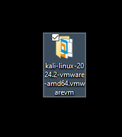</a><figcaption>Paso 1.1</figcaption></figure>
</div>

### Ejecución

Dentro de la carpeta hay muchos archivos. Los de extensión .vmdk puedes ignorarlos. El que importa es el que termina en .vmx, que es el ejecutable para *VMware*. En *VirtualBox*, la extensión relevante es .vbox.


<div class="gallery">
  <figure class="shot"><a href="/assets/img/PasosKali/Kali2.1.png" data-lightbox>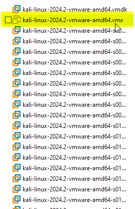</a><figcaption>Paso 2.1</figcaption></figure>
  <figure class="shot"><a href="/assets/img/PasosKali/Kali2.2.png" data-lightbox>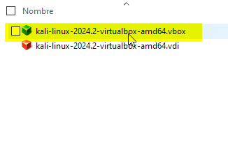</a><figcaption>Paso 2.2</figcaption></figure>
</div>

Al abrir las imágenes que ya tenemos, el software nos deja ajustar algunas opciones según las capacidades de nuestro equipo y su memoria instalada.

<div class="gallery">
  <figure class="shot"><a href="/assets/img/PasosKali/Kali3.1.png" data-lightbox>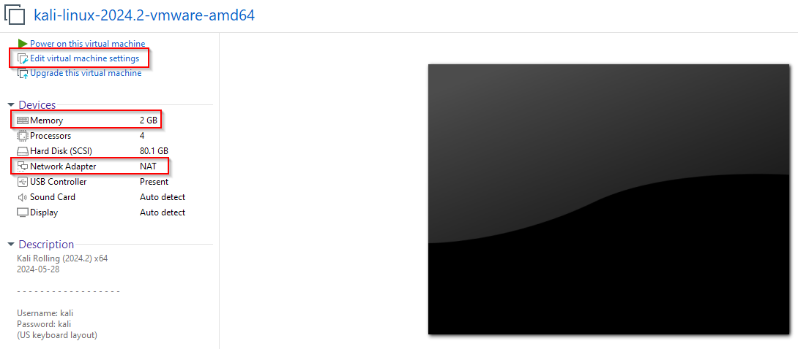</a><figcaption>Paso 3.1</figcaption></figure>
</div>

En *VirtualBox* hay opciones parecidas:

<div class="gallery">
  <figure class="shot"><a href="/assets/img/PasosKali/Kali3.2.png" data-lightbox>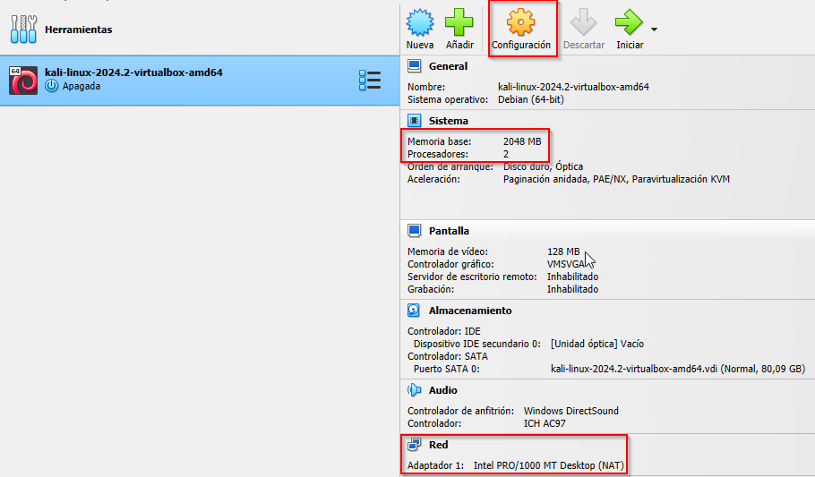</a><figcaption>Paso 3.2</figcaption></figure>
</div>

### Configuración

Estos son los ajustes que recomiendo editar:

- Núcleos del procesador: más núcleos dan mejor rendimiento a la máquina virtual.
- Memoria disponible: permite ejecutar más tareas y con mayor rapidez.
- Red: aquí hay dos opciones.

	- **NAT**: el entorno crea una red interna aislada de la red de tu equipo, y asigna direcciones IP a otras máquinas virtuales dentro de esa red.
	- *Bridged* o Adaptador Puente: simula que los equipos son máquinas físicas dentro de tu red de casa u oficina.
		
Para hacer estos ajustes, en *VMware* selecciona Edit virtual machine settings. En *VirtualBox* usa el ícono con forma de tuerca arriba a la derecha, que dice Configuración. Lo muestro en las siguientes imágenes.

En *VMware* lo más relevante es subir la memoria RAM a 8 gigas. La configuración por defecto asigna 4 núcleos del procesador, que en este caso es perfecto.

<div class="gallery">
  <figure class="shot"><a href="/assets/img/PasosKali/Kali4.1.png" data-lightbox>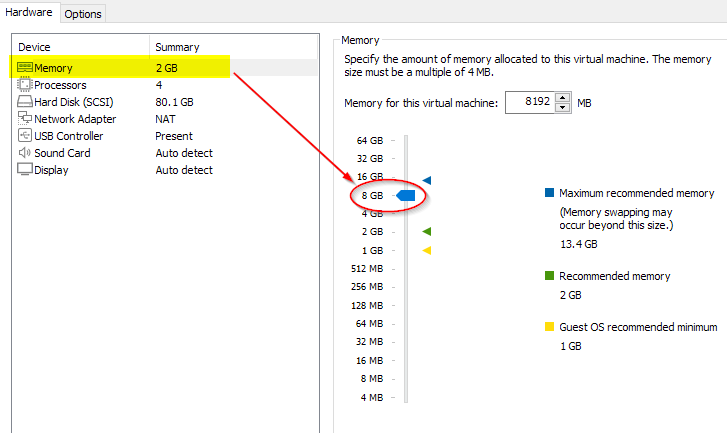</a><figcaption>Paso 4.1</figcaption></figure>
</div>

En *VirtualBox* las opciones cambian un poco. Hay que ajustar los procesadores asignados, porque con solo 2 núcleos es posible que la máquina virtual no rinda bien. Ten en cuenta las capacidades de tu computadora: un equipo decente suele tener al menos 6 u 8 núcleos, así que puedes darle la mitad a la máquina virtual.

Para la memoria RAM, asigna al menos 4 GB. Con 8 GB la mejora se nota bastante.

<div class="gallery">
  <figure class="shot"><a href="/assets/img/PasosKali/Kali4.2.png" data-lightbox>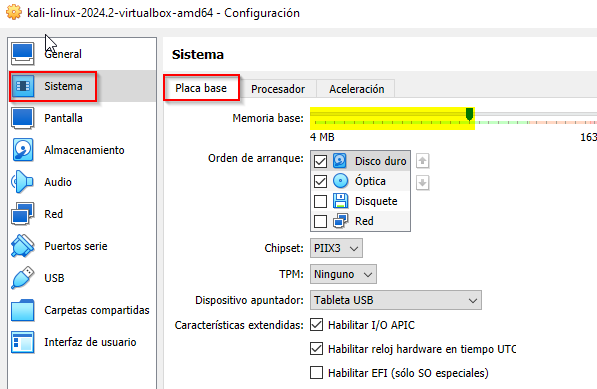</a><figcaption>Paso 4.2</figcaption></figure>
  <figure class="shot"><a href="/assets/img/PasosKali/Kali4.2.1.png" data-lightbox>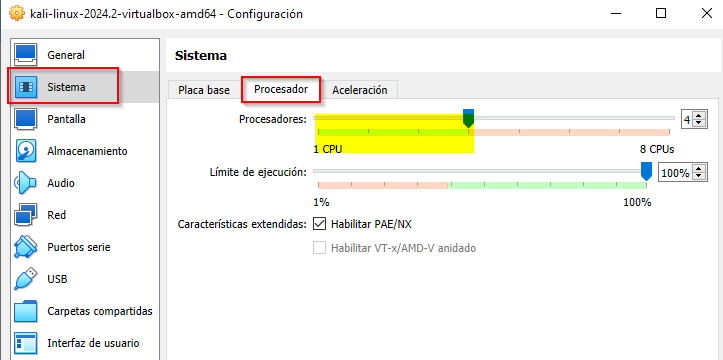</a><figcaption>Paso 4.2.1</figcaption></figure>
</div>

> Con estos ajustes, algunos equipos van a topar con los límites de su *hardware*. Juega con los valores para sacarle el mejor rendimiento a tu máquina, sin incendiarla en el proceso.


Para la red, NAT funciona bien para casi todos. Da más *limpieza* al escanear equipos de tu red local, por ejemplo en los *CTF* (Capture the Flag), porque evita que aparezcan teléfonos, televisores o bombillas inteligentes.

Con Bridged o Adaptador puente, esos dispositivos sí aparecen en el escaneo. Esta opción sirve más en entornos empresariales, donde se buscan vulnerabilidades y hace falta integración completa con la red.

> La elección depende de lo que necesites. Lo aclaro porque casi nadie explica por qué existen estas opciones.

En *VMware*, aparece esta selección:

<div class="gallery">
  <figure class="shot"><a href="/assets/img/PasosKali/Kali5.1.png" data-lightbox>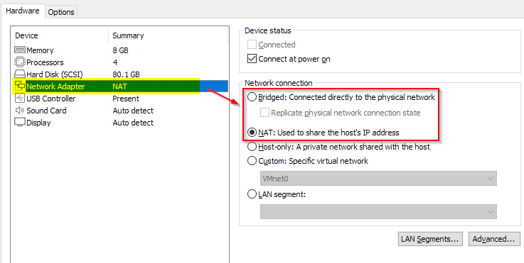</a><figcaption>Paso 5.1</figcaption></figure>
</div>

Y en *VirtualBox* este menú:

<div class="gallery">
  <figure class="shot"><a href="/assets/img/PasosKali/Kali5.2.png" data-lightbox>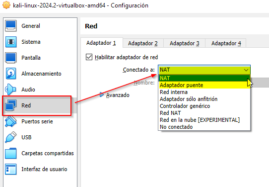</a><figcaption>Paso 5.2</figcaption></figure>
</div>

> Notarás casillas adicionales en las imágenes anteriores. Si piensas usarlas, investiga primero para qué sirven. Pueden dejar a tu Kali sin acceso a Internet o impedirle detectar otros equipos de la red.

### Primer arranque

Enciende la máquina con la opción que corresponda.

En *VMware*, Power on this virtual machine:

<div class="gallery">
  <figure class="shot"><a href="/assets/img/PasosKali/Kali6.1.png" data-lightbox>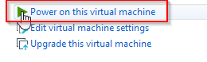</a><figcaption>Paso 6.1</figcaption></figure>
</div>

En *VirtualBox*, Iniciar:

<div class="gallery">
  <figure class="shot"><a href="/assets/img/PasosKali/Kali6.2.png" data-lightbox>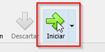</a><figcaption>Paso 6.2</figcaption></figure>
</div>

Kali empezará a cargar:


<div class="gallery">
  <figure class="shot"><a href="/assets/img/PasosKali/Kali7.1.png" data-lightbox>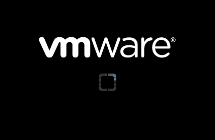</a><figcaption>Paso 7.1</figcaption></figure>
  <figure class="shot"><a href="/assets/img/PasosKali/Kali8.1.png" data-lightbox>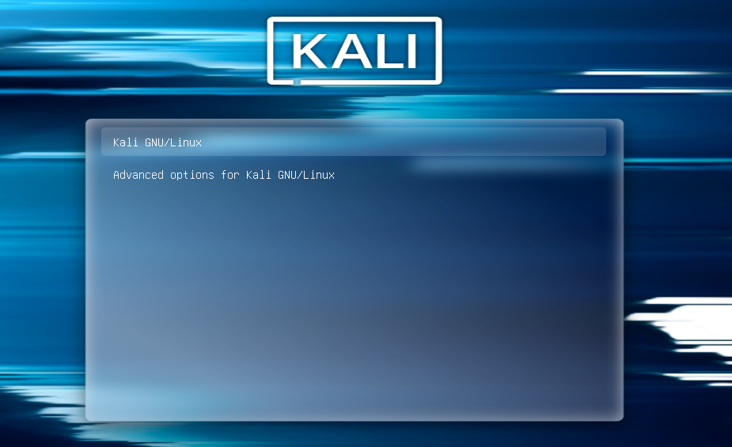</a><figcaption>Paso 8.1</figcaption></figure>
</div>

Hasta llegar a la pantalla de inicio de sesión:

- Usuario: kali
- Contraseña: kali

<div class="gallery">
  <figure class="shot"><a href="/assets/img/PasosKali/Kali9.1.png" data-lightbox></a><figcaption>Paso 9.1</figcaption></figure>
</div>

Si todo salió bien, ya estás dentro de tu Kali "cero kilómetros", listo para empezar a *hackear*. Pero un momento: todavía falta un poco.

<div class="gallery">
  <figure class="shot"><a href="/assets/img/PasosKali/Kali10.1.png" data-lightbox>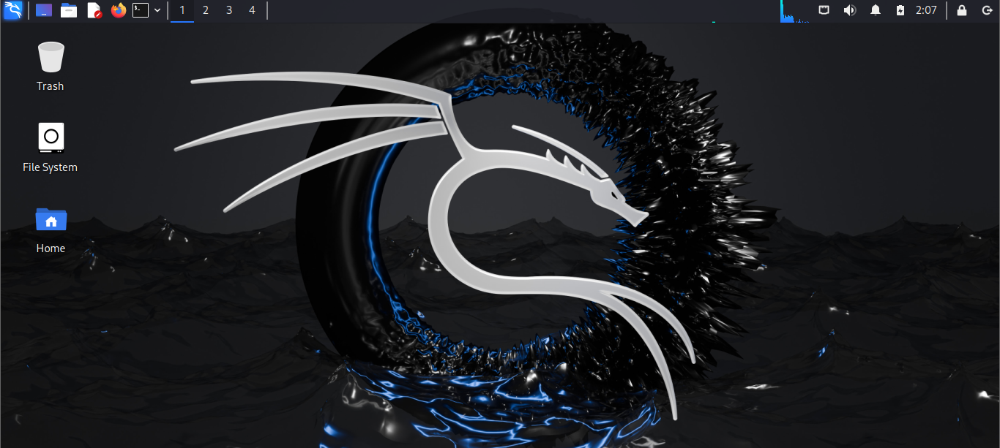</a><figcaption>Paso 10.1</figcaption></figure>
</div>

Estas son las herramientas que vienen preinstaladas:

<div class="gallery">
  <figure class="shot"><a href="/assets/img/PasosKali/Kali11.1.png" data-lightbox>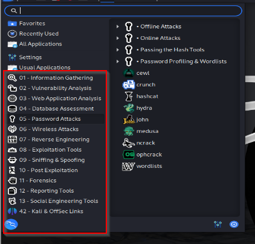</a><figcaption>Paso 11.1</figcaption></figure>
</div>


## Mejorar mi Kali

Kali ya está listo y funcional, pero se le puede sacar más partido con los siguientes detalles.

### Cambiar contraseña

Lo primero, si quieres trabajar como un profesional, es **cambiar la contraseña predeterminada**: es pública y fácil de adivinar. Puedes hacerlo con el siguiente comando:

<div class="gallery">
  <figure class="shot"><a href="/assets/img/PasosKali/Kali12.1.png" data-lightbox>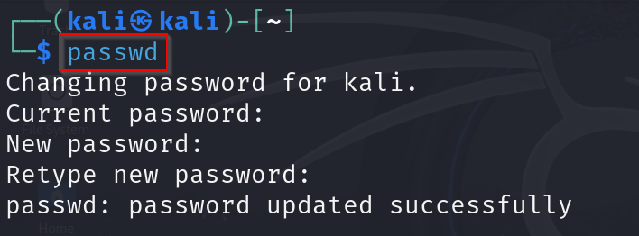</a><figcaption>Paso 12.1</figcaption></figure>
</div>

> Toma un minuto, pero ayuda a crear el hábito de proteger con contraseña las acciones importantes.  


Además de la de tu usuario, conviene cambiar la del usuario *root* (el administrador total del sistema) para mejorar la seguridad general.


```bash
┌──(kali㉿kali)-[~]
└─$ sudo su root # Cambiamos a root
[sudo] password for kali: #Tu contraseña actual de Kali

┌──(root㉿kali)-[~]
└─# passwd        
New password: # Una contraseña compleja para root
Retype new password: # La repetimos
passwd: password updated successfully
```

Con esos dos detalles listos, vamos a *chulear* el sistema con herramientas más potentes para futuras prácticas de ataque y explotación en el laboratorio.

### Pimpmykali

Esta suite de soluciones para Kali fue recopilada y mejorada por [Dewalt-arch](https://github.com/Dewalt-arch "Dewalt-arch"). En la práctica te simplifica la vida: deja el sistema más completo y te ahorra dolores de cabeza.

Entre las mejoras que aporta:

- Agrega herramientas y *scripts* de ataque, entre ellos:
	- ghidra (ensambla y decompila código / ingeniería inversa)
	- bettercap (para sniffear y atacar redes)
	- pymetasploit (agrega una interfaz python para Metasploit)
	- volatility (herramienta para análisis forense de memoria RAM)
	- repara impacket, agrega una versión estable (se utiliza para ataques de directorio activo de Windows)
	- Agrega funcionalidades adicionales a programas ya instalados
	- Incluye nuevos diccionarios de directorios y contraseñas
- Instala, actualiza y configura todo con una tecla.
- Agrega mejoras de personalización para el sistema.

#### Descarga

Primero creamos una carpeta en el escritorio para mantener el orden. Podemos hacerlo desde la línea de comandos:

<div class="gallery">
  <figure class="shot"><a href="/assets/img/PasosKali/Kali13.1.png" data-lightbox></a><figcaption>Paso 13.1</figcaption></figure>
</div>

```bash

┌──(kali㉿kali)-[~]
└─$ cd /home/kali/Desktop #Con esto vamos a nuestro escritorio

┌──(kali㉿kali)-[~/Desktop]
└─$ mkdir pmk #Creamos una carpeta con el nombre que queramos

┌──(kali㉿kali)-[~/Desktop]
└─$ cd pmk #Nos posicionamos dentro de la carpeta

```

Ahora descargamos Pimpmykali dentro de esa carpeta:

<div class="gallery">
  <figure class="shot"><a href="/assets/img/PasosKali/Kali14.1.png" data-lightbox>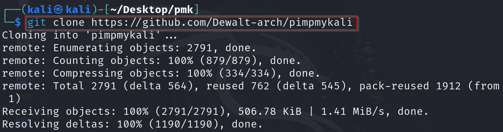</a><figcaption>Paso 14.1</figcaption></figure>
</div>

Enlace del Repositorio: [https://github.com/Dewalt-arch/pimpmykali](https://github.com/Dewalt-arch/pimpmykali "De Dewalt-arch")

```bash

┌──(kali㉿kali)-[~/Desktop/pmk]
└─$ git clone https://github.com/Dewalt-arch/pimpmykali #El comando git clone permite descargar repositorios desde Github

```

#### Instalación

Con la descarga lista, entramos a la carpeta que acabamos de bajar para instalarlo:

<div class="gallery">
  <figure class="shot"><a href="/assets/img/PasosKali/Kali15.1.png" data-lightbox></a><figcaption>Paso 15.1</figcaption></figure>
</div>

```bash

┌──(kali㉿kali)-[~/Desktop/pmk]
└─$ dir #Veremos el nombre de la carpeta que acabamos de descargar
pimpmykali

┌──(kali㉿kali)-[~/Desktop/pmk]
└─$ cd pimpmykali #Ingresamos a la carpeta

┌──(kali㉿kali)-[~/Desktop/pmk/pimpmykali]
└─$ ls #Nos permite ver los contenidos de la carpeta
changelog.txt fixed-http-shellshock.nse pimpmykali.sh README.md # Contenido

```

> Puedes hacer estos pasos como prefieras. Solo te ofrezco una forma ordenada para que tu área de trabajo se mantenga limpia y encuentres tu información con facilidad.


Ejecutamos el archivo pimpmykali.sh así:

<div class="gallery">
  <figure class="shot"><a href="/assets/img/PasosKali/Kali16.1.png" data-lightbox>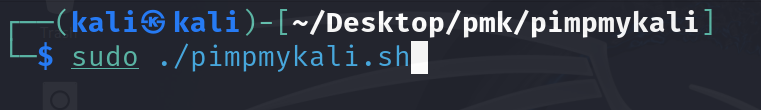</a><figcaption>Paso 16.1</figcaption></figure>
</div>

```bash

┌──(kali㉿kali)-[~/Desktop/pmk/pimpmykali]
└─$ sudo ./pimpmykali #Con sudo corremos todo lo que instale el script con permisos de "root", utilizamos ./ para no agregar la palabra bash y aprovechamos que el archivo cuenta con permisos de ejecución.

```


Esto abre el menú de Pimp my Kali:

<div class="gallery">
  <figure class="shot"><a href="/assets/img/PasosKali/Kali17.1.png" data-lightbox>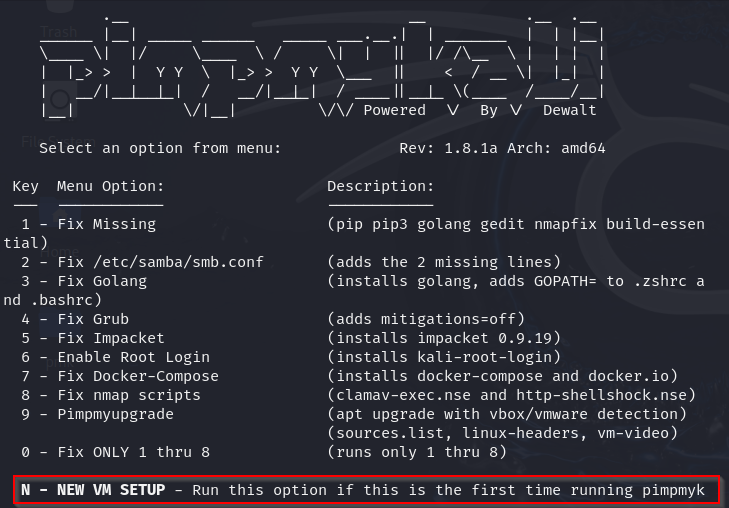</a><figcaption>Paso 17.1</figcaption></figure>
</div>

El menú principal del *script* ofrece varias opciones para distintos momentos. Conviene entender cada una antes de usarla, para no hacer cambios innecesarios. Las más usadas son:

- El 9: permite actualizar Kali mediante este script, según el virtualizador que estés usando y añadiendo repositorios adicionales.
- El 0: aplica las mejoras de los puntos 1 al 8, pero sin actualizar.

Para esta guía usaremos la opción *N*, que aplica todas las mejoras descritas y agrega repositorios para herramientas que ya están instaladas.

> Todo el proceso puede tardar entre 15 minutos y 1 hora, según la velocidad de tu internet.

Al terminar la instalación de todos los paquetes verás una imagen como esta:

<div class="gallery">
  <figure class="shot"><a href="/assets/img/PasosKali/Kali18.1.png" data-lightbox></a><figcaption>Paso 18.1</figcaption></figure>
</div>

#### Actualización

Para cerrar el proceso, actualiza todas las herramientas.

Puedes volver a ejecutar el *script* y elegir la opción 9:

<div class="gallery">
  <figure class="shot"><a href="/assets/img/PasosKali/Kali18.2.png" data-lightbox>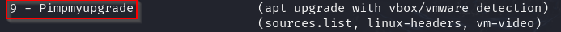</a><figcaption>Paso 18.2</figcaption></figure>
</div>

O recurrir a la forma convencional:

<div class="gallery">
  <figure class="shot"><a href="/assets/img/PasosKali/Kali19.1.png" data-lightbox>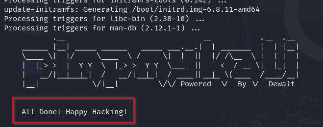</a><figcaption>Paso 19.1</figcaption></figure>
</div>

```bash

┌──(kali㉿kali)-[~/Desktop/pmk/pimpmykali]
└─$ sudo apt update #Verifica todos los repositorios y que estos contengan versiones actualizadas de nuestros programas

┌──(kali㉿kali)-[~/Desktop/pmk/pimpmykali]
└─$ sudo apt upgrade -y #Realiza la actualización de los programas que pueden actualizarse

┌──(kali㉿kali)-[~/Desktop/pmk/pimpmykali]
└─$ sudo apt autoremove #Esto eliminará todos los paquetes descargados para que no ocupen espacio en disco

```

> Es posible que el script de pimpmykali ya haya hecho este proceso, pero al repetirlo a mano te aseguras de que todo esté al día y, de paso, liberas espacio en disco.

> Nota adicional: es probable que debas desactivar el antivirus del sistema principal, porque algunos enlaces a repositorios pueden detectarse como sospechosos. Esto ocurre porque no están en las listas de confianza para Kali Linux, y eso puede bloquear la descarga de los scripts o programas desde esos enlaces.

Con esto queda lista tu instalación de Kali Linux. Lo primero que haría ahora es tomar una instantánea de la máquina, para volver a este punto limpio cuando algo salga mal.

---

Utiliza estos enlaces para volver a arriba o salir de la publicación:

- [Volver al Inicio](/Kali-Linux-para-Hackers/ "Regresar al inicio de este post")
- [Portada del blog](/ "Ir a la pantalla principal")
