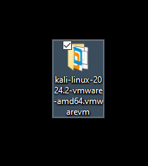
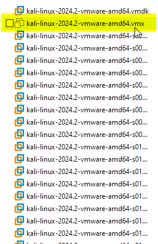
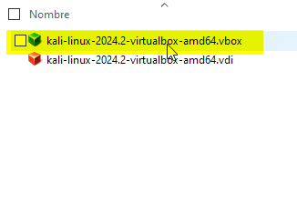

## Dónde practicar sin romper nada

Nadie debería lanzar su primer escaneo desde la computadora donde guarda sus fotos y su banco. Necesitas un lugar donde equivocarte sin consecuencias, y ese lugar es una **máquina virtual**: una computadora simulada dentro de la tuya. Aquí te explico cómo funcionan los *virtualizadores*, comparo los tres más usados y te ayudo a elegir.

Los candidatos:

- VMware Workstation Pro
- VirtualBox
- Hyper-V

> La gran ventaja es que tu laboratorio queda **aislado** de tu sistema principal. Si rompes algo, o si un *malware* de práctica se sale de control, restauras una instantánea y sigues como si nada.

## Antes de empezar: activa la virtualización

Todos necesitan que tu procesador tenga activada la virtualización por hardware (*Intel VT-x* o *AMD-V*). Para comprobarlo en Windows:

1. Abre el Administrador de tareas (`Ctrl + Shift + Esc`).
2. Ve a Rendimiento y luego a CPU.
3. Busca la línea Virtualización. Debe decir *Habilitado*.

Si dice *Deshabilitado*, entra a la BIOS/UEFI de tu equipo (normalmente con `F2`, `F10` o `Supr` al encender) y activa la opción *Intel Virtualization Technology*, o *SVM Mode* en procesadores AMD.

> Tu equipo también cuenta. Para un laboratorio cómodo recomiendo 16 GB de RAM y un disco SSD. Con 8 GB funciona, pero tendrás que repartir la memoria con cuidado entre las máquinas.

## Los tres candidatos

### VMware Workstation Pro

Desde mayo de 2024, Broadcom ofrece **VMware Workstation Pro gratis para uso personal**. Es el que más recomiendo para empezar: es estable, tiene muy buen rendimiento gráfico y la mayoría de máquinas de práctica se distribuyen listas para VMware.

Enlace de descarga: [VMware](https://support.broadcom.com/group/ecx/productdownloads?subfamily=VMware+Workstation+Pro "VMware for personal use")

> Descargarlo desde la página de Broadcom es algo engorroso, porque pide crear una cuenta. Les dejo un video para que lo hagan sin tropiezos: [Tutorial descarga de VMware](https://www.youtube.com/watch?v=W2PLaqcK8Yc "Tutorial para descargar VMware de Nazareno Anselmi")

- A favor: rendimiento, *snapshots* fiables, buen manejo de redes virtuales y de USB.
- En contra: la descarga es engorrosa y no es de código abierto.

### VirtualBox

VirtualBox, de Oracle, es gratuito y de código abierto, y funciona en Windows, Linux y macOS con procesador Intel. Es ligero y muy fácil de usar.

Enlace de descarga: [VirtualBox](https://www.virtualbox.org/wiki/Downloads "VirtualBox")

- A favor: gratis, multiplataforma y con una comunidad enorme.
- En contra: rinde un poco menos en gráficos, y algunas funciones (como USB 3.0) requieren el *Extension Pack*, que tiene su propia licencia para uso personal.

### Hyper-V

Hyper-V viene incluido en Windows 10 y 11 Pro, Enterprise y Education (no en la edición Home). Es un hipervisor de *tipo 1*, el mismo que usa Microsoft en sus servidores, así que el rendimiento es excelente.

Para activarlo, abre PowerShell como administrador y ejecuta:

```powershell
Enable-WindowsOptionalFeature -Online -FeatureName Microsoft-Hyper-V -All
```

También puedes hacerlo desde *Panel de control > Programas > Activar o desactivar las características de Windows*. Al terminar, reinicia el equipo.

- A favor: ya lo tienes si usas Windows Pro, es muy eficiente y se integra con WSL2 y Docker.
- En contra: la interfaz es más austera, el manejo de gráficos y USB es limitado, y casi ninguna máquina de práctica viene preparada para Hyper-V.

> Ojo con esto: cuando Hyper-V está activo, controla la virtualización del procesador. VMware y VirtualBox siguen funcionando encima de él, pero más lentos. Si notas tus máquinas pesadas, revisa si Hyper-V, WSL2 o la *Seguridad basada en virtualización* de Windows están encendidos.

## Comparativa rápida

<div class="table-wrap">
<table>
<thead><tr><th></th><th>VMware Workstation Pro</th><th>VirtualBox</th><th>Hyper-V</th></tr></thead>
<tbody>
<tr><td>Precio</td><td>Gratis uso personal</td><td>Gratis</td><td>Incluido en Windows Pro</td></tr>
<tr><td>Sistemas anfitrión</td><td>Windows, Linux</td><td>Windows, Linux, macOS (Intel)</td><td>Solo Windows</td></tr>
<tr><td>Rendimiento</td><td>Muy alto</td><td>Bueno</td><td>Muy alto</td></tr>
<tr><td>Facilidad de uso</td><td>Alta</td><td>Muy alta</td><td>Media</td></tr>
<tr><td>Instantáneas</td><td>Sí (<em>Snapshots</em>)</td><td>Sí (<em>Instantáneas</em>)</td><td>Sí (<em>Puntos de control</em>)</td></tr>
<tr><td>Máquinas de práctica listas</td><td>Muchas</td><td>Muchas</td><td>Pocas</td></tr>
</tbody>
</table>
</div>

## Abrir una máquina ya preparada

La forma más rápida de empezar es usar una máquina que ya viene configurada, como las que ofrece [Kali Linux](https://www.kali.org/get-kali/#kali-virtual-machines "Kali Linux"). Al descomprimir el archivo descargado obtendrás algo similar a esto:

<div class="gallery">
  <figure class="shot"><a href="/assets/img/PasosKali/Kali1.1.png" data-lightbox></a><figcaption>Paso 1.1</figcaption></figure>
</div>

Dentro de la carpeta aparecen varios archivos con extensión .vmdk, que son los discos virtuales y puedes ignorar. El que importa en *VMware* es el que termina en .vmx, y en *VirtualBox* el que termina en .vbox. Haz doble clic sobre él y el virtualizador lo abrirá.

<div class="gallery">
  <figure class="shot"><a href="/assets/img/PasosKali/Kali2.1.png" data-lightbox></a><figcaption>Paso 2.1</figcaption></figure>
  <figure class="shot"><a href="/assets/img/PasosKali/Kali2.2.png" data-lightbox></a><figcaption>Paso 2.2</figcaption></figure>
</div>

En Hyper-V el camino es distinto: creas una máquina nueva con el asistente (*Acción > Nuevo > Máquina virtual*) e instalas el sistema desde su imagen ISO.

El paso a paso completo, con la configuración de memoria, procesador y red, está en la guía de [Kali Linux para Hackers](/Kali-Linux-para-Hackers/).

## Buenas prácticas para tu laboratorio

- Toma una instantánea justo después de instalar y configurar. Es tu botón de "volver a empezar".
- Usa la red en modo NAT o Solo anfitrión (*Host-only*) para practicar. El modo Puente (*Bridged*) pone la máquina en tu red real, así que úsalo solo cuando lo necesites.
- No compartas carpetas entre tu equipo y una máquina donde analizas *malware*.
- Mantén tu virtualizador actualizado: también tiene vulnerabilidades, y algunas permiten escapar de la máquina virtual al sistema anfitrión.

::: leccion
- Activa la virtualización en la BIOS/UEFI antes de instalar nada.
- Si empiezas desde cero, VMware Workstation Pro es gratis para uso personal y la mayoría de máquinas de práctica vienen listas para él.
- Si prefieres código abierto, o usas Linux o Mac Intel, VirtualBox es tu opción.
- Si tienes Windows Pro y ya usas WSL2 o Docker, Hyper-V te da rendimiento sin instalar nada más.
- Elijas lo que elijas, las instantáneas y el aislamiento de red son lo que convierte una máquina virtual en un laboratorio seguro.
:::

---

Elige uno hoy, instala una máquina de práctica y toma tu primera instantánea. Si ya usas alguno de los tres, cuéntame en los comentarios por qué.
